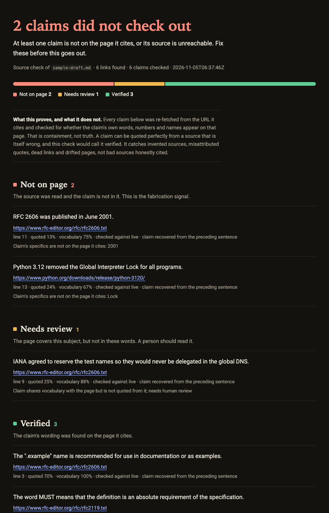
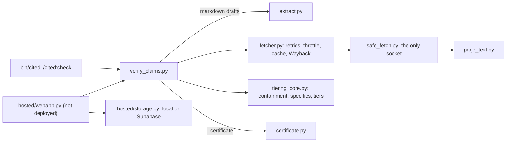

# cited

[](https://github.com/OrenSegal/cited/actions/workflows/ci.yml) [](LICENSE)

cited re-fetches every page a claim cites and flags claims whose words, numbers or names are not on it. It is for anyone shipping LLM answers with citations, as a Claude Code plugin or a standard-library Python 3.10+ command; part of [sous](https://github.com/OrenSegal/sous).

On 29 hand-labelled claims about one page, it flags 10 of the 15 that are not on it: recall 0.67, 95% bootstrap CI 0.41-0.90 ([Results](#results)). It checks containment, not truth.

Try it from a fresh clone (fetches six live pages; exit 1 means some claims did not check out, as two should here):

`git clone https://github.com/OrenSegal/cited && cd cited && bin/cited docs/examples/sample-draft.md`

[](docs/examples/sample-certificate.html)

*A sample certificate, rendered locally by the command-line tool, not a page from a live service. `docs/examples/render.sh` ran `cited sample-draft.md --certificate` against the live pages for six claims about RFC 2606, RFC 2119 and the Python 3.12.0 release (3 verified, 1 needs review, 2 not on page), then screenshotted the HTML with headless Chrome ([HTML](docs/examples/sample-certificate.html), [draft](docs/examples/sample-draft.md), [JSON](docs/examples/sample-report.json)).*

`hosted/` holds a certificate web app (Vercel + Supabase + Stripe). **It is not deployed**: there is no public URL, nothing has been sold through it, and its demo lane is off unless `CITED_DEMO_MAX_CLAIMS` is set. It runs locally; see [hosted/README.md](hosted/README.md).

## Components



Why it is built this way, with the alternatives that were rejected:
[docs/decisions.md](docs/decisions.md).

## Why

Asking the model that wrote a claim how sure it is does not catch a claim it made up. cited checks the page instead, fetched fresh, with a Wayback Machine fallback when the live page is gone or empty.

- **Containment, not similarity.** String-similarity scores divide by the length of both texts, so a real quote on a long page scores near zero. cited divides by the claim alone, so page length can neither hide nor manufacture a match.
- **Quotation and vocabulary are scored separately.** Shared word sequences show quotation. Shared vocabulary survives rewording but only shows the claim is on the same topic, so a vocabulary-only match is `low_match` and needs a person.
- **Specifics must be on the page.** Numbers (with their scale, so `$40 billion` does not pass for `$40 million`), capitalized names and identifiers like `Series B` in the claim must all appear on the page, or the claim is `unsupported`.
- **Fair to sites that block bots.** Sites such as Reddit, X and LinkedIn refuse scripted fetches. Those come back `snippet_only`, not as fabrications or dead links.

## Results

- **Made-up funding round.** "Acme Robotics raised a $12M Series A led by Sequoia", checked against a page that only names the company, scores `unsupported`, as does a quoted claim with the wrong number (`$12M` for `$15M`) or the wrong scale (`$40 billion` for `$40 million`). Pinned in `tests/test_tiering_core.py` ([cited#1](https://github.com/OrenSegal/cited/pull/1)).
- **Offline research-note eval.** `evals/catch-fabricated-citation` hands an agent a note with five claims about RFC 2606 and recorded copies of the pages. Expected: two quotes verified, the wrong year (2001 for 1999) not on the page, the paraphrase sent to a person, the citation of a nonexistent RFC reported as broken.
- **Labelled benchmark.** `python3 bench/run.py` (offline, no keys) scores cited on 29 hand-labelled claims about the recorded RFC 2606 page: 15 that are not on it, 14 that are. It flags 10 of the 15 (recall 0.67) and also flags 5 of the 14 supported ones (all `low_match`: paraphrases sent to a person). The five misses are a number written as a word (`six` for `four`) and four swapped lowercase words or phrases (`demo` for `example`, `valid` for `invalid`, `rejected` for `agreed`, `production DNS servers` for testing of DNS code). Precision of the flags is also 0.67 (10 of 15). With n = 29, the 95% bootstrap intervals over claims are wide: recall 0.41-0.90, precision 0.42-0.91 (`bench/run.py` prints both; 2000 resamples, seed 0). The claims and their labels were written in one commit (3a407b3) by the tool's author, with Claude as co-author; there is no second labeller. That is the precision/recall trade-off in the thresholds: the current bar sends 5 of the 14 supported claims to a person and still passes all 5 misses as `verified`. A stricter bar could catch some swaps at the cost of more real quotes sent to a person; that has not been measured. One page, one labeller, 29 claims: a regression check and a picture of the lexical approach, not an accuracy estimate for the web.
- **Where it falls short.** The same RFC page let a swapped lowercase word pass as `verified`; see [Limitations](#limitations).

## Install

As a Claude Code plugin:

```text
/plugin marketplace add OrenSegal/cited
/plugin install cited@cited
```

This adds the `cited` skill, the `/cited:check` command, and puts `cited` on the Bash tool's PATH while the plugin is enabled.

Without Claude Code, clone the repo and run `bin/cited` (or `python3 skills/cited/scripts/verify_claims.py`). There is nothing to install.

## Use

In Claude Code, ask for it in plain words ("check the citations in report.md before I send it") and the skill takes over, or run the command:

```text
/cited:check report.md
/cited:check claims.json --strict
```

From a shell:

```bash
cited claims.json                          # table on stdout, exit code says whether to ship
cited claims.json --json > report.json     # machine-readable report
cited claims.json --annotate-out out.json  # input written back with a tier on every entry
cat claims.json | cited -                  # read from stdin
```

Input is a JSON array. `claim` and `source_url` are required; `id` (string or integer) is optional and used in the report. Other keys are kept.

```json
[
  {"id": "revenue", "claim": "Northwind reported revenue of $48 million for fiscal 2025.", "source_url": "https://example.com/results"},
  {"id": "funding", "claim": "Northwind raised a $12M Series A in March.", "source_url": "https://example.com/news"}
]
```

### From a markdown draft

Point cited at a `.md`, `.markdown` or `.mdx` file and it finds every inline link, works out which claim each link is being asked to support, and checks those pairs the same way. Numbered markers (`[1]` with a numbered entry under a Sources heading), footnotes (`[^1]` with a `[^1]: url` note) and reference-style links (`[text][ref]`) are resolved to their URLs first.

```bash
cited draft.md                              # check every sourced claim in the draft
cited draft.md --certificate cert.html      # also write an HTML certificate to hand someone
cited draft.md --extract-only               # show the claim/source pairs, no network
```

Links land in three buckets, decided without a model: `checkable` (a sentence that asserts something, with a source), `repaired` (a trailing `[Source](url)` after the sentence it supports, so the claim is taken from the sentence before), and `excluded` (a bare "here" or "the docs", a link under a Sources or References heading, a relative path, or text too short to assert anything). Excluded links are listed, never fetched, and never affect the exit code: a link with no claim attached cannot pass a containment check, so failing it would be a broken check, not a finding. A link that shares a sentence with other links is given only the part of the sentence it sits in, so it is not blamed for another source's numbers.

An invalid file is rejected before anything is fetched, with every problem listed by its zero-based position (`claims.json[0]: missing required field 'source_url'`).

## Tiers

| Tier | Label | Meaning | Blocks by default | Blocks with `--strict` |
|---|---|---|---|---|
| `verified` | Verified | The claim is substantially quoted from the live (or archived) page. | no | no |
| `low_match` | Needs review | The claim shares vocabulary with the page but is not quoted from it. A made-up claim about a real company also shares its name with the company's site, so a person must check it. | yes | yes |
| `unsupported` | Not on page | The page loaded and is readable, and the claim, or one of its numbers or names, is not on it. The fabrication signal. | yes | yes |
| `broken` | Broken source | The URL is invalid, refused (see Security), or unreachable, and no archived copy helped. | yes | yes |
| `unverified` | Unverified | Never checked: the page is a PDF or binary, too thin to read (a JavaScript app, a consent wall), too large to read in full and the claim was not in the part read, or missing from an `--offline` cache. | no | yes |
| `snippet_only` | Snippet-only | The site blocks scripted fetches and no archived copy exists: HTTP 429 from any site, or HTTP 403 or a bot challenge page from a site on the built-in list (reddit.com, x.com, twitter.com, linkedin.com, glassdoor.com, indeed.com). A 403 from any other site is `broken`. | no | yes |

## Exit codes

| Code | Meaning |
|---|---|
| 0 | Nothing blocking. |
| 1 | At least one blocking claim. |
| 2 | Usage error or invalid claims file. Nothing was fetched. |
| 3 | `--offline` and at least one source had no cached copy, and no other code applies. |
| 4 | An internal error while checking a claim, or `--annotate-out` or `--certificate` could not be written, and nothing was blocking. The other claims are still checked and reported. |
| 5 | No claim was checked: the input had no claims, or no link in the draft had a claim attached. |
| 130 | Interrupted. |

## Options

| Flag | Default | |
|---|---|---|
| `--json` | off | Print the JSON report (below) instead of the table. |
| `--annotate-out PATH` | | Write the input back with `verification_tier`, `verification_note` and `verified_at` on every entry. |
| `--strict` | off | Also block on `unverified` and `snippet_only`. |
| `--certificate PATH` | | Also write an HTML certificate of the run: a verdict, every claim with its tier and note, and (for a draft) the links that were not checked and why. |
| `--extract-only` | off | Markdown input only. Print the claim/source pairs the draft yields and exit, with no network. |
| `--timeout SEC` | 10 | Per-request limit, connect through last byte. |
| `--retries N` | 2 | Retries for timeouts, connection errors, 429 and 5xx, with exponential backoff and jitter. Bot-walled sites are not retried. |
| `--concurrency N` | 4 | Claims checked in parallel. Each URL is fetched once per run, however many claims cite it. |
| `--per-host-delay SEC` | 1.0 | Minimum gap between requests to the same host. |
| `--no-wayback` | off | Do not look dead or empty pages up on the Wayback Machine. |
| `--max-bytes N` | 5000000 | Read at most this much of each page. |
| `--max-redirects N` | 5 | Follow at most this many redirects. |
| `--cache DIR` | | Reuse fetched pages from `DIR`, and store new ones there. |
| `--offline` | off | Never touch the network; use only `--cache`. |
| `--allow-host HOST`, `--allow-private-addresses`, `--proxy-from-env` | off | Relax the address policy. Read SECURITY.md first. |

`cited --help` prints the same list.

## JSON report

`--json` prints one object. Fields are only added in later versions; a breaking change bumps `schema_version`.

```json
{
  "schema_version": 1,
  "cited_version": "x.y.z",
  "checked_at": "2026-10-01T12:00:00Z",
  "options": {"strict": false, "offline": false, "wayback": true},
  "summary": {
    "total": 2,
    "counts": {"unsupported": 1, "broken": 0, "low_match": 0, "unverified": 0, "snippet_only": 0, "verified": 1},
    "blocking": "disqualifying",
    "offline_misses": 0,
    "internal_errors": 0,
    "exit_code": 1
  },
  "results": [
    {
      "index": 1,
      "id": "funding",
      "claim": "Northwind raised a $12M Series A in March.",
      "source_url": "https://example.com/news",
      "tier": "unsupported",
      "label": "Not on page",
      "blocking": true,
      "note": "Claim's specifics are not on the page it cites: 12, 12 million",
      "quoted": 0.25,
      "topical": 0.6,
      "checked_against": "live",
      "http_status": 200,
      "fetched_url": "https://example.com/news",
      "snapshot_url": null
    }
  ]
}
```

- `summary.counts` always has every tier, most severe first.
- `summary.blocking` is `null`, `"disqualifying"` (unsupported or broken), `"needs_review"` (low_match), or `"unchecked"` (unverified or snippet_only under `--strict`).
- `results` is in input order. `id` is the input `id` as a string, or `#<index>` when there is none.
- `quoted` and `topical` are 0 to 1: the share of the claim's word sequences, and of its distinctive words, found on the page.
- For a markdown draft, each result also has `line` (where the link is) and `bucket` (`checkable` or `repaired`), and the report has a top-level `draft` object: `path`, `links` (every inline link found) and `excluded` (one `{id, line, link_text, source_url, reason}` per link that was not checked).
- `checked_against` is `live`, `wayback` or `none`. `http_status` and `fetched_url` describe the live fetch (`null` if there was no response). `snapshot_url` is the Wayback capture used, if any.

## Reproducible runs and CI

Record once with network, then replay without it:

```bash
cited claims.json --cache .cited-cache            # fetches and stores every page and Wayback lookup
cited claims.json --cache .cited-cache --offline  # same verdicts, no network; exit 3 on a cache miss
```

Each cache entry is one JSON file per URL. Errors that might be temporary (timeouts, 5xx, 429) are not cached. Commit the directory to pin a CI check to the pages as they were when you recorded them; delete it to re-check against today's pages. A cache directory is trusted input: whoever can write to it decides the results.

### Optional pre-ship check

cited does not install any hook. If you want one, these block only when you add them.

A git pre-push hook (`.git/hooks/pre-push`, executable) that checks a claims file when one exists:

```sh
#!/bin/sh
[ -f claims.json ] || exit 0
exec cited claims.json   # add --strict to also block on unchecked claims
```

A CI step (GitHub Actions) that replays a committed cache:

```yaml
- name: Check citations
  run: python3 path/to/cited/skills/cited/scripts/verify_claims.py claims.json --cache .cited-cache --offline
```

## Security

cited fetches URLs an agent wrote, so it treats them as hostile. Only `http` and `https` are fetched. Loopback, private, link-local, cloud-metadata and other non-public addresses are refused, including after a redirect, when a hostname resolves to one, and for odd spellings such as `2130706433` or `[::ffff:127.0.0.1]`. The check runs on the exact address being connected to, so DNS rebinding does not get around it. Redirects, response size and time are capped, and fetched content is never executed. [SECURITY.md](SECURITY.md) lists exactly what is and is not enforced, and the flags that relax it.

## Limitations

- **The accuracy numbers are thin.** The benchmark is 29 claims about one page, written and labelled by the tool's author, so recall 0.67 has a 95% interval of 0.41-0.90 and says nothing about other sites, languages or claim styles. The 15 unsupported claims are of two kinds the author chose: edits of the page's own sentences (a swapped word, number or name) and invented facts about the RFC. Dead links, bot walls and invented URLs are covered by tests, not by this benchmark.
- **Matching is lexical.** It compares words and word sequences. It cannot tell whether a reworded claim means the same as the page, or whether a quoted line means what your artifact says.
- **Substituted lowercase words pass.** Only numbers, capitalized words and one-letter identifiers are checked as specifics. `"The .demo TLD is recommended for use in documentation"` checked against RFC 2606 (which says `.example`) came back `verified`, because every other word is quoted.
- **Numbers written as words are not checked.** `"reserves seven top level domain names"` against a page that says "four" came back `low_match`, not `unsupported`. It still blocks, but for the wrong reason.
- **Dates are not normalised.** Abbreviated month names and other date formats are not matched to each other. `"published in October 2023"` against a page that says "Oct. 2, 2023" came back `unsupported` (Not on page), because `October` is checked as a name the page does not use.
- **Negation and qualifiers are invisible.** "did not raise" and "raised" share most of their words.
- **Numbers are checked against nearby words, and only roughly.** A number in a quoted claim must sit within a few words of a word the claim puts next to it, in the same sentence. `"founded in 2022"` on a page that says 2019 and mentions 2022 elsewhere comes back `low_match`, and so do swapped percentages. It is a heuristic, so it asks for a person and never says `unsupported`: a real claim that moves a number far from its words also lands in `low_match`, and a wrong number that happens to sit near one of the claim's words still passes.
- **English-centric.** The capitalized-name heuristic skips the claim's first word (so an invented name there passes) and ordinary openers such as "Moreover" in later sentences, misses lowercase brand names, and can flag an ordinary capitalized word the page does not use.
- **No JavaScript.** Pages that render in the browser come back thin (`unverified`) unless their meta description or JSON-LD carries the claim, or the Wayback copy has text.
- **Pages change.** A claim can be `verified` today and gone tomorrow, or vice versa. Every annotated entry carries `verified_at`, and `--cache` pins a run to the pages it saw.
- **Wayback is a fallback, not an oracle.** The closest capture may be older or newer than the page you cited.
- **A server can show cited something different** from what it shows a person (cloaking, geo or login walls). cited reports what it was served.

### What it does not do

| You want | cited | Use instead, or as well |
|---|---|---|
| Know whether a claim is true | Only whether it is on the cited page | A human, or a fact-checking process with independent sources |
| Judge a paraphrase or summary | Flags it as `low_match` for a person | An LLM or NLI entailment check on the page text, with a human for disputes |
| Check PDFs, papers or DOIs | Reports `unverified` | A PDF text extractor, or Crossref/DOI metadata tools |
| Check pages that need a browser, a login or a paywall | Reports `unverified`, `snippet_only` or `broken` | A headless browser you control |
| Monitor links over time | One run per call | A scheduled link checker, or cited in a scheduled CI job |
| Find a source for an uncited claim | Needs a `source_url` | Search, then cited to check what you found |

## Evals

`evals/` holds a [`claude plugin eval`](https://code.claude.com/docs/en/plugin-evals) suite: one case where a note mixes quoted, misdated, paraphrased and dead citations, one where a request has no URLs and the skill must stay out of the way, and one with an invalid claims file. They call a model and cost money, so CI does not run them. To run them yourself:

```bash
claude plugin eval . --allow-tools Bash Write "WebFetch(domain:www.rfc-editor.org)" "WebFetch(domain:archive.org)"
```

The network grants are needed because Bash runs sandboxed, and `catch-fabricated-citation` fetches RFC 2606.

## Development

See [CONTRIBUTING.md](CONTRIBUTING.md). `skills/cited/references/methodology.md` explains the scoring.

## License

MIT. See [LICENSE](LICENSE).

## Background

cited began as the source-verification step of [signal-scout](https://github.com/OrenSegal/signal-scout).
